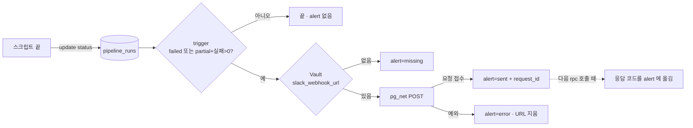

# 운영 현황 화면 `/admin/ops` — 수집·분석·검수·반영·재빌드가 돌고 있는지 한 화면에서

> 최종 수정: 2026-10-28 (v15: **실행이 어떻게 끝났나를 일 기준으로 말한다** — 저장된 status 넷으로는 Ctrl+C·Claude 한도·끝 기록 없이 죽은 함수가 전부 "실패" 라, 10-07 의 `중단(SIGINT)` 이 20일 동안 빨간 "마지막 수집이 실패했어요" 로 섰고 머리글은 20일 묵은 분석 요청에 "서버 워커가 곧 받아요" 라고 했다. `src/lib/runOutcome.ts` 가 `error` 분류 문구(`scripts/lib/runErrors.mjs` — 스크립트와 같은 값)와 `progress` 로 여덟 갈래(도는 중·끝·일부는 다음에·사람이 멈춤·한도로 멈춤·실패·중간에 끊김·끝 무렵 멈춤)를 가르고 머리글·다섯 칸·실행 표가 그것만 읽는다. 머리글은 일꾼(PC 워커·서버 워커)이 아니라 일이 머리말이고, 요청이 2시간 넘게 그대로면 "N일 전부터 그대로예요 · 아무도 안 가져갔어요". 수집도 진행(검색어 n/m + 저장 한 칸)을 적고, 새 실행이 설 때 심장이 30분 넘게 멎은 `running` 행을 `기록 없이 끝남` 으로 닫는다(`runLog.closeLostRuns` — 원격에 그런 행이 9건 있었다))
> 이전 2026-10-28 (v14: **분석 칸의 주의 기준을 요청한 글 2시간으로**(todo/15 T8.6 — 사용자 결정 2026-10-27) — 저수지(일부러 안 읽는 글, ADR-024 결정 4)의 나이를 세던 옛 기준 "미분석 2일" 은 서버 워커 운영에서 칸을 늘 노랗게 했다. 이제 `ops_overview.oldestRequestAt`(요청 글·「지금 분석」 요청 중 가장 오래된 것, 마이그레이션 `20261028130000`)이 2시간을 넘을 때만 주의, 미분석 수는 둘째 줄 정보. 칸이 없는 원격은 주의를 띄우지 않는다(옛 규칙으로 돌아가지 않는다). 안내는 분석 버튼이 아니라 「서버에서 이어 돌리기」)
> 이전 2026-10-27 (v13: **운영자 화면의 남은 `반영` 두 뜻을 갈랐다**(todo/06 D#9·#10) — 사이트 쪽은 `갱신`(`사이트가 갱신됐어요`·`사이트에서 갱신되지 않았어요`), 스크립트 단계는 명령 이름(`pnpm data apply`)과 짝이라 `반영` 그대로, 재빌드 머리글 `걸렸어요`(시작됐다/멈췄다 양방향) → `시작했어요`)
> 이전 2026-10-19 (v12: **Slack 꺼짐 문구의 내부 용어**(14 W261010.14b) — ⑤ 알림 본문에서 `T5`·`Vault`·`slack_webhook_url` 을 걷고 "아직 Slack 연결이 준비되지 않았어요" 로, 원값은 묶음 밑 접이식 `원래 값 보기`(.14a 와 같은 모양). 켜진 상태는 그대로.)
> 이전 2026-10-19 (v11: **재빌드 칸 사유의 내부 용어**(14 W261010.14a) — 주소 없음·폐기·한도·예약 멈춤의 `reason` 에서 `Deploy Hook`·`Vault`·`cron.job` 을 걷고 운영자 말("연결 주소"·"예약 작업")로. 원값은 `TStageHealth.detail` → 띠 밑 접이식 `원래 값 보기`. 판정(429 한도·5xx 는 폐기 아님)은 그대로.
> 이전 2026-10-16 (v10: **운영자 말·정상 기준**(14 W261010.14) — 다섯 칸 밑 「무엇이 정상인가요?」 접이식(칸별 기준 + 쉬는 중·워커·심장 뜻, 숫자는 판정 상수에서), 재빌드 칸 `201` → `접수됨`, 실행 기록 펼침의 영문 키 → 한글, 실패 줄에 `이후 성공(N 전)`. 분석 칸 주의 기준 자체는 🙋 T8.6 대기.
> 이전 2026-10-13 (v9: **폰 배치**(todo/15 T8.5) — 다섯 칸은 폰에서 세로 다섯 줄(가로로 밀면 검수·반영·재빌드가 잘렸다)·md 부터 한 줄, 상태점 범례 한 줄, 누를 수 있는 칸에 `›`, 실행 기록 칩은 `/admin` 과 같은 `AdminFilterChip`.
> 이전 2026-10-13 (v8: **기록이 안 오는 칸을 걷었다**(todo/15 T8.3) — 실행 기록 `승인` 칩 삭제 · 검수 칸은 `/admin` 검수 대기 링크 · 흐름의 `승인 · 제외` → `등록 · 제외`(수는 그대로).
> 이전 2026-10-13 (v7: **판정 안내가 빌드별**(todo/15 T8.2) — 띠·칸·실행 기록의 할 일 문장이 `/admin` 과 같은 `nextStepText` 표를 쓴다. 서버 빌드에서 터미널을 말하면 PC 를 켜야 하는 줄 알기 때문이다. 서버 길이 없는 수집(키워드 전체 수집)·끊긴 후보 없는 실패 반영은 두 빌드 다 터미널. 아래 「③」)
> 이전 2026-10-13 (v6: **지금 상태는 `/admin` 머리글과 같은 한 줄**(todo/15 T8.1) — 워커 칸·서버 한 줄을 걷고 `opsLiveStatus` → `AdminLiveStatusLine` 하나로. 잃는 것: 기기 이름 · `외 N대` · 서버 빌드의 PC 워커 멎음(돌던 실행은 분석 칸 `중단된 듯` 이 잡는다). 「들어오고 나가는 길」 의 "열 때 한 번 — 구독하지 않는다" 를 바로잡았다. 아래 「⓪」)
> 이전 2026-10-08 (v5: **서버 워커 배지**(todo/20 T7 · ADR-028 결정 7) — 로컬 배지(`workerHealth`)는 `host = vercel` 행을 세지 않고, 서버는 도는 동안만 `서버 · 분석 중` 한 줄(`remoteWorkerView`). 아래 「⓪」)
> 이전 2026-10-07 (v4: **로컬 워커 칸과 Realtime 구독**(todo/17 T5 · ADR-024 결정 6) — 다섯 칸 위에 워커 배지·단계·심장·대기 요청·진행 막대, `workers`·`pipeline_runs` 를 구독해 집계를 다시 부르지 않고 그 자리에서 고친다. 60초 폴링은 안전망으로 남는다)
> 이전 2026-10-06 (v3: 재빌드 횟수는 `rebuild_log` 행이 아니라 **호출**(서로 다른 `request_id`)을 센다 — 뒤쪽 합치기로 한 호출에 여러 행이 붙는다(ADR-018 결정 9 v7). `queued` 는 재빌드 칸에서 대기로 본다)
> 이전 2026-10-06 (v2: **화면 구현**(todo/15 T3) — 판정 규칙을 구현에 맞췄다: 재빌드 429 는 주의(BUG-011) · 수집·반영도 중단된 듯을 본다 · 반영 실패에 `failed` 크래시 포함. 승인·제외 막대는 한 칸에 위·아래, 알림 묶음엔 테스트 버튼이 아직 없다(T1.3·T6). 재빌드 칸 문장 중복과 "`src/` 가 `scripts/` 를 import 하는 길은 없다" 를 고쳤다)
> 이전 2026-10-06 (v1: 제안 — 화면 명세와 UI/UX 설계. 코드 없음)
> 상태: **구현 중** — 화면(`/admin/ops`)은 섰고 Slack(T5·T6)은 보류. 왜 이런 모양인지는 [ADR-023](../decisions/ADR-023-ops-dashboard-and-run-log.md), 진행은 [todo/15](../todo/15-ops-dashboard.md).

이 화면이 답하는 질문은 하나다 — **"지금 어디가 막혀 있나, 아니면 다 괜찮나."** `/admin` 이 후보를 올리는 자리라면, 여기는 그 장치가 도는지 보는 자리다. 운영자(개발자 한 명)가 PC 에서 10초 훑고 닫는 것을 기준으로 설계한다. 핸드폰은 "읽힌다" 까지만.

## 누가, 언제 연다

| 장면 | 보고 싶은 것 | 그래서 화면은 |
|---|---|---|
| 주말에 "이번 주 수집 돌렸던가?" | 마지막 수집이 언제였고 성공했는지 | 맨 위 다섯 칸 중 **수집** 칸의 "N일 전 · 정상" 한 줄 |
| `analyze` 를 돌려 놓고 자리를 비웠다 | 끝났는지, 죽었는지, 몇 건 했는지 | **분석** 칸이 `돌고 있음(3분 전 심장)` 또는 `중단된 듯` 또는 `끝남 · 47건` |
| `/admin` 에서 등록했는데 사이트가 안 바뀐다 | 반영 → 재빌드 어디서 끊겼나 | **반영** 칸의 "approved 인데 반영 안 됨 2건" 또는 **재빌드** 칸의 4xx 경고 |
| 한 달 지나 "이거 비용이 얼마나 들지" | Claude 토큰·재빌드 횟수 | **사용량** 묶음의 30일 합계 |
| Slack 에 실패 알림이 왔다 | 어떤 실행이 왜 실패했나 | 알림 링크 → 이 화면의 **실행 기록** 그 행이 펼쳐진 상태 |

## 화면 구성

```
┌──────────────────────────────────────────────────────────────────────────────┐
│ 운영 현황                                    ← 검수 화면 · 새로고침 · 42초 전 │
│ 재빌드를 시작했어요(2분 전 · 201)                              ← /admin 과 같은 줄│
├──────────────────────────────────────────────────────────────────────────────┤
│ ⚠ 수집이 9일째 없어요 · 요청한 글이 안 읽혔어요(3시간 전 요청) ← 주의 띠      │
├──────────────────────────────────────────────────────────────────────────────┤
│ ① 파이프라인                                                                 │
│ ┌──────────┐ ┌──────────┐ ┌──────────┐ ┌──────────┐ ┌──────────┐             │
│ │● 수집    │ │● 분석    │ │○ 검수    │ │● 반영    │ │● 재빌드  │             │
│ │9일 전    │ │2시간 전  │ │대기 31   │ │3일 전    │ │2분 전    │             │
│ │신규 12   │ │47건 미분석│ │오래된 8일│ │끊긴 0    │ │7일 6회  │             │
│ │7일 넘음  │ │5일째 쌓임│ │          │ │          │ │201      │             │
│ └──────────┘ └──────────┘ └──────────┘ └──────────┘ └──────────┘             │
├──────────────────────────────────────────────────────────────────────────────┤
│ ② 흐름  [7일] [30일]                                                         │
│ 신규 글 12 ███                                                                │
│ 분석    73 ████████████████████                                               │
│ 후보    41 ███████████                                                        │
│ 등록    18 █████             제외 15 ████                                     │
│ 반영    18 █████                                                              │
│ 재빌드   6 ██                                                                 │
│ 지금 보류 31 ████████   ← 기간 무관, 노랑                                     │
├──────────────────────────────────────────────────────────────────────────────┤
│ ③ 실행 기록  [전체] [수집] [분석] [반영]   [실패만]                           │
│ 시각        스크립트   상태    소요    요약                              알림  │
│ 2시간 전    analyze    ●끝남   41분    분석 47건 (후보 23 · 일치 9 · …)   —    │
│ 어제 21:03  analyze    ●실패   3분     Claude 인증 실패                  Slack │
│ 9일 전      collect    ●끝남   2분     수집 120건 (신규 12 · 기존 108)   —    │
│ …                                                                   더 보기   │
├──────────────────────────────────────────────────────────────────────────────┤
│ ④ 사용량(30일)   Claude 입력 1.2M · 출력 180k · 캐시 940k │ 네이버 검색 2,400 │ 재빌드 22  │
│ ⑤ 알림          Slack 웹훅 있음 · 마지막 발송 어제 21:03(200)   [테스트 보내기]│
└──────────────────────────────────────────────────────────────────────────────┘
```

### ⓪ 지금 상태 — `/admin` 머리글과 같은 한 줄

지금 무엇이 도는지는 `/admin` 머리글의 실시간 한 줄이 정본이다. 이 화면은 다섯 칸 위에 **같은 함수**(`adminLiveStatus.liveStatus` — 운영 현황은 `opsLiveStatus`)로 **같은 줄**(`AdminLiveStatusLine`)을 그린다 — 따로 판정하지 않는다. 전에는 이 화면이 `workerHealth` + `remoteWorkerView` 로 따로 판정해, PC 워커를 끄고 서버만 깨우는 평상시에 `/admin` 은 `쉬는 중`, 여기는 노란 `워커 없음` 으로 서로 반대로 말했다. 그래서 `remote`(`HAS_SERVER_WORKER`)를 반드시 같이 넘긴다 — 빠지면 서버 빌드의 이 화면만 PC 워커 꺼짐을 경고한다(테스트가 잡는다).

- **한 줄** — 머리말은 **일**이다: `분석 중`(꼬리말 `서버에서`·`PC에서`) · `PC에서 로그인 필요`·한도 휴식 · `분석 요청이 N일 전부터 그대로예요`(요청이 `REQUEST_STALE_HOURS` 를 넘으면 — 분석 칸과 같은 기준) · `요청 N건 대기`(막 들어온 것) · 도는 일이 없으면 마지막 일이 어떻게 끝났는지(`수집 12/53에서 사람이 멈춤` · `분석 끝 · 9건은 다음 실행에 다시`, 꼬리말 `N일 전 · 지금 도는 일 없음`). 끝난 일의 문장은 `runOutcome` 하나가 정한다. 도는 중이면 진행 막대와 지금 읽는 글 한 줄. 오른쪽의 `실시간`·`운영 현황 →`·`목록 새로 읽기`·깨우기 실패·남은 일 줄은 `/admin` 만의 것이라 여기엔 없다(머리글이 이미 `실시간 꺼짐 — 60초마다` 를 말한다).
- **잃은 것** — 기기 이름 · `외 N대`(로컬 워커가 둘 이상일 때만 뜻이 있었다) · 서버 빌드에서 PC 워커의 꺼짐·멎음(서버가 받는 빌드에서 PC 워커의 없음은 고장이 아니라 `liveStatus` 가 말하지 않는다). `kill -9` 로 죽은 PC 워커가 돌던 실행은 분석·수집·반영 칸의 `중단된 듯`(`runState` 의 심장 10분 — `runningOrFailed`)이 대신 잡는다.
- **빌드마다 다르다** — `workers` 키가 없으면(마이그레이션 전 응답) 줄을 안 그린다: 모르는 것을 `워커 없음` 으로 말하지 않는다.

**PC 워커 판정**(`adminOpsHealth.workerHealth`, 단위 테스트)은 `liveStatus` 가 부른다. **`last_seen_at` 이 5분 넘게 멎으면 멎은 듯** — `kill -9` 로 죽은 워커는 행이 그대로 남으니 행이 있다는 것만으로 켜져 있다고 말하지 않는다. 단 **로그인 기다림·한도 휴식은 멎은 듯보다 먼저다**: 로그인을 기다리는 워커는 세션이 끝나 심장 쓰기도 실패하므로 5분 규칙을 먼저 보면 그 배지가 영영 안 뜬다. 그때 심장이 멎었으면 문구에 "워커가 꺼졌을 수도 있어요" 를 붙인다.

**서버 워커는 따로 본다.** 서버 행(`host = vercel`)은 홉 사이마다 멎은 모양이라 로컬 판정에 섞으면 PC 워커가 멀쩡한데 `워커 멎음` 이 뜬다 — `workerHealth` 는 그 행을 세지 않는다(`others` 에도). 서버는 `last_seen_at` 이 60초 안이고 단계가 `idle` 이 아닐 때만 `서버 워커 · 분석 중`(`remoteWorkerView`)이고 줄에서 PC 워커보다 먼저 고른다.

**구독**(`src/lib/adminOpsRealtime.ts`): 채널 `ops:N` 하나에(구독마다 순번 — 같은 이름이면 떠나는 중인 채널을 돌려받아 StrictMode·HMR 재구독이 던진다) `workers`·`pipeline_runs` 의 `postgres_changes`(`*`). 받은 행으로 **상태만** 고친다 — 워커는 host 로 바꿔 끼우고, 실행 행은 실행 기록 목록(지금 걸러 보기에 맞을 때만 — 안 맞게 된 행은 뺀다) · 다섯 칸이 읽는 `runsLatest`/`runsLastOk` · 링크로 연 행을 함께 고친다. 진행 막대만 움직이고 분석 칸이 옛 상태를 말하면 한 화면이 두 말을 한다. `ops_overview` 는 다시 부르지 않는다(심장 15초·진행 5초마다 집계 rpc 를 부르면 화면 하나가 DB 를 두드린다). 60초 폴링은 그대로 — 끊겼다 다시 붙으면 한 번 조용히 다시 읽어 그 사이를 메운다. `SUBSCRIBED` 가 아니면 머리글에 작게 `실시간 꺼짐 — 60초마다`.

### ① 파이프라인 다섯 칸 — 한 줄 진단

순서는 장치가 도는 순서다(수집 → 분석 → 검수 → 반영 → 재빌드). [ADR-020](../decisions/ADR-020-pipeline-stages-and-blocklist.md) 의 다섯 칸(수집 완료 · 검수 대기 · 등록 완료 · 등록 해제 · 블랙리스트)은 **후보가 지금 어디 있나**를 가르는 상태이고, 여기 다섯 칸은 **장치가 어디까지 돌았나**를 가르는 단계라 축이 다르다 — 이름이 달라야 맞고, `/admin` 탭과 같은 낱말(검수·반영)만 같은 뜻으로 쓴다. 칸마다 네 줄:

| 줄 | 수집 | 분석 | 검수 | 반영 | 재빌드 |
|---|---|---|---|---|---|
| 상태점 + 이름 | ● | ● | ○(사람 몫이라 색을 약하게) | ● | ● |
| **첫째 수**(마지막) | 마지막 ok 실행 상대 시각 | 마지막 ok 실행 또는 `돌고 있음(심장 N분 전)` | 후보 N행(`/admin` 검수 대기는 곳으로 묶어 세어 더 적다) | 마지막 ok 실행 | 마지막 `rebuild_log` 행의 상대 시각 · 응답 코드 |
| **둘째 수**(쌓인 것) | 그 실행의 신규 N | `N건 미분석`(저수지 포함 — 정보뿐, 색을 바꾸지 않는다) | 가장 오래된 pending 며칠 · 곳으로는 /admin | approved 인데 merged 아님 N(= `countStrandedCandidates`) | 7일 훅 호출 수(서로 다른 `request_id`) |
| 판정 이유(주의·실패일 때만) | `수집이 N일째 없어요` | `요청한 글이 안 읽혔어요(N시간 전 요청)`(가장 오래된 요청 글·「지금 분석」 요청이 2시간 넘음 — `REQUEST_STALE_HOURS`) / `분석이 중단된 듯해요 — 프로세스가 죽었으면 그냥 다시 돌리면 돼요` | `검수 N일째 대기` | `반영 안 된 승인 N건` / `마지막 반영에서 N건이 실패했어요` | `Deploy Hook 이 폐기된 듯해요(4xx)` · `재빌드가 한도(시간당 60번)에 걸렸어요` 등 |

상태점은 넷이다 — **정상**(초록 `success`) · **주의**(노랑 `warning`) · **실패**(빨강 `error`) · **기록 없음**(회색, "아직 한 번도 안 돌았어요"). 판정 규칙은 `src/lib/adminOpsHealth.ts` 한 곳이 소유하고 단위 테스트가 붙는다. 재빌드 칸은 `rebuildHeadline()` 의 문장(`{tone, text}`)을 파싱하지 않고 `ops_overview.rebuildRecent` 의 행(`response_status`·`hook`·`requested_at`)을 직접 받는다 — 건너뛰기 규칙(`latestRebuildCall`)과 응답 대기 한도는 `adminRebuild.ts` 의 것을 그대로 쓰고, 머리글 한 줄은 그대로 `rebuildHeadline` 이 만든다. 칸을 누르면 ③ 실행 기록이 그 스크립트로 걸러진다(한 번 더 누르면 전체). **검수 칸은 걸러 보지 않고 `/admin/?tab=candidates`(검수 대기)로 가는 링크다** — 사람 몫이라 볼 곳이 거기고, `/admin` 등록·제외는 실행 기록을 남기지 않아(옛 `data:review` 의 approve·reject 2행이 10-06 이후 그대로) 걸러 봐도 언제나 그 옛 행만 나왔다. 재빌드 칸은 `rebuild_log` 라 걸러 볼 실행 기록이 없어 누를 수 없다. 띠에는 `worstStage` 하나 — 실패가 주의보다 먼저, 같은 무게면 장치 순서상 앞의 것.

판정 규칙(권장 기본값 — 임계값은 🙋, [todo/15](../todo/15-ops-dashboard.md)):

| 칸 | 실패 | 주의 | 기록 없음 |
|---|---|---|---|
| 수집 | 마지막 실행이 정말 실패(`runOutcome` 의 `failed`) · 중간에 끊김(`lost`). **사람이 멈춤(Ctrl+C)·끝 무렵 멈춤은 실패가 아니다** — 첫 줄만 `사람이 멈춤 · N일 전` 이 되고 색은 오른쪽 규칙 | 마지막 ok 가 **7일** 넘음 · Claude 한도로 멈춤 | `collect` 행이 0 |
| 분석 | 마지막 실행이 정말 실패 · 중간에 끊김(`running` 인데 `heartbeat_at` 이 **10분** 넘고 진행이 덜 찼다, 또는 `기록 없이 끝남` 으로 닫힌 행) | 미분석 글 > 0 이고 가장 오래된 미분석 글의 `fetched_at` 이 **2일** 넘음 | `analyze` 행이 0 |
| 검수 | — (사람 몫, 실패가 없다) | 가장 오래된 pending 이 **7일** 넘음 | pending 0 → "비었어요"(정상) |
| 반영 | 마지막 `apply` 가 정말 실패(크래시 — stats 없음) · 실패 건수 > 0 · 중간에 끊김 | approved 인데 merged 아닌 후보 > 0 | — |
| 재빌드 | 마지막 `sent` 행의 `response_status` 가 4xx·5xx — **429 는 빼고** | `missing`·`error` · **429**(시간당 60번 한도 — 훅은 멀쩡하다, [BUG-011](../bugs/BUG-011-rebuild-429-read-as-revoked-hook.md)) · 응답 null 이 3분 넘음(`rebuildHeadline` 과 같은 기준) | `rebuild_log` 0 |

"운영자가 `/admin` 에서 승인하면 반영이 곧바로 일어난다"(ADR-018) 는 사실 때문에 **반영 칸의 주의는 거의 끊긴 반영(등록 도중 실패 · 옛 CLI 승인이 남은 것)에서만 선다.** 그게 서면 끊긴 후보를 다시 반영하라는 뜻이다 — 서버 빌드는 `/admin` 머리글의 「서버에서 반영」, 로컬 빌드는 `pnpm data apply`(아래 ③ 의 할 일 문장 표). `data:review`·`data:apply` 는 ADR-024 로 `pnpm data …` 가 됐다.

### ② 흐름 — 어디서 쌓이나

기간(7일 · 30일) 안에서 **그 기간에 각 단계를 지난 건수.** rpc `ops_overview(days)` 한 번이 센다. 줄들은 서로의 부분집합이 **아니다**(이번 주 분석된 글이 지난주 수집된 글일 수 있다) — 그래서 "깔때기" 라도 비율은 **가장 큰 줄을 100%** 로 둔다. 보류(pending)는 기간 흐름이 아니라 **지금 쌓인 것**이라 줄을 따로 뗀다.

| 줄 | 세는 것 | 어디서 |
|---|---|---|
| 신규 글 | `fetched_at` 이 기간 안인 글(`ignoreDuplicates` 라 **새로 들어온 글만** 센다 — 실행 기록의 "수집 120건" 과 다른 수다) | `blog_posts` |
| 분석 | `analyzed_at` 이 기간 안인 글 | `blog_posts` |
| 후보 | `created_at` 이 기간 안인 후보 | `candidates` |
| 등록 · 제외 | `reviewed_at` 이 기간 안인 후보 — 등록 = `status in ('approved','merged')`(반영되면 `merged` 로 바뀌므로 `approved` 만 세면 빠진다), 제외 = `rejected`. `reviewed_at` 은 트리거가 approved/rejected 로 바뀔 때만 채우므로 pending 은 여기 없다 | `candidates` |
| 지금 보류 | 현재 `status='pending'` 수(기간 무관 — ① 검수 칸의 대기 수와 같은 값) | `candidates` |
| 반영 | `extracted.applied.at` 이 기간 안인 후보 | `candidates` |
| 재빌드 | `hook='sent'` 이고 응답 2xx 인 행 | `rebuild_log` |

막대는 **가장 큰 줄을 100% 로 둔 비율**이다. 색은 한 가지(`bg-brand-solid` 의 약한 톤), 줄마다 다른 색을 쓰지 않는다 — 비교하는 축이 "얼마나 지났나" 하나뿐이다. 승인·제외는 한 줄에 둘 — 단 **같은 막대 칸 안에 위(등록)·아래(제외)로** 겹친다(반쪽 칸 둘로 나누면 그 줄만 막대 칸이 절반 폭이라 같은 수가 절반 길이로 보인다), **지금 보류 줄만 노랑**(`warning` 토큰)이다 — 그게 사람이 할 일이다. 수 0 인 줄은 막대 없이 `0` 만 쓴다. 차트 라이브러리를 들이지 않는다 — `div` 너비 하나다. 구현 전에 `dataviz` 스킬의 "stat tile · 비율 막대" 절을 한 번 읽는다.

### ③ 실행 기록 — 무슨 일이 있었나

`pipeline_runs` 를 최신순으로. `adminTable` + `adminInfiniteScroll` 재사용. 열은 여섯:

| 열 | 내용 | 비고 |
|---|---|---|
| 시각 | 상대("2시간 전"), 호버·탭에 절대(KST) | `started_at` |
| 스크립트 | `collect` · `analyze` · `apply` (+ 옛 `approve`/`reject` 2행 — 지금은 안 쌓인다, 아래 「읽는 법」) | `adminTypeChip` 과 같은 알약 모양, 색은 회색 하나 |
| 상태 | `runOutcome` 의 라벨 — 도는 중 · 끝 · 끝(일부는 다음에) · 사람이 멈춤 · 한도로 멈춤 · 실패 · 중간에 끊김 · 끝 무렵 멈춤 | 상태점: 끝·도는 중 초록, 일부·한도 노랑, 실패·끊김 빨강, 사람이 멈춤·끝 무렵 멈춤 회색. 요약이 없는 줄은 분류 문구(`중단(SIGINT)`) 대신 `12/53에서 사람이 멈춤` |
| 소요 | `ended_at − started_at`, 돌고 있으면 "N분째" | 분석은 보통 수십 분 |
| 요약 | 콘솔 요약 줄을 `stats` 에서 **그대로 다시 만든 문장** | 터미널에서 본 것과 같은 말이어야 한다 |
| 알림 | `—` · `Slack` · `Slack 실패` | `alert` 칸 |

행을 펼치면 `stats` 의 전부(토큰 · 제외 사유별 수 · 좌표 보강 · 홈페이지), `args`(플래그 목록), `error` 한 줄, 알림 request_id 가 키-값으로 선다. 필터는 칩 둘 — 스크립트(`전체`·수집·분석·반영 — approve·reject 칩은 없다, 옛 행은 `전체` 에서만 보인다), `실패만`(= `failed`·`partial`·중단된 듯). URL 에 `?run=<id>` 가 오면 그 행이 펼쳐진 채 스크롤된다 — Slack 메시지의 링크가 여기로 온다.

**중단된 듯** 행에는 버튼이 없다. 운영자가 할 일은 터미널에서 다시 돌리는 것이다. `runLock`(`scripts/lib/runLock.mjs`)은 잠금을 쥔 pid 가 죽어 있으면 **알아서 이어받으므로** 락 파일을 지울 필요가 없다 — 행 아래 한 줄은 "프로세스가 죽었으면 그냥 다시 돌리면 돼요. 살아 있는데 멎어 있으면 그 프로세스를 끊고 다시" 다. 행을 손으로 `failed` 로 닫는 버튼은 두지 않는다 — 기록을 화면이 고치기 시작하면 정본이 둘이 된다. 대신 **다음 실행이 닫는다**: `beginRun` 이 자기 행을 세운 뒤 심장이 **30분**(`LOST_AFTER_MS` — 화면의 10분보다 넉넉히, 긴 호출에 걸린 산 실행을 닫지 않게) 넘게 멎은 `running` 행을 `failed` + `기록 없이 끝남` 으로, `ended_at` 은 마지막 심장으로 닫는다(`closeLostRuns`). 진행은 그대로 두어 `12/40에서 끊김` 과 `끝 무렵 멈춤`(진행이 끝까지 찼다 — 서버 함수가 `end` 직전에 잘린 꼴)이 갈린다. 수집은 저장을 진행의 마지막 한 칸으로 세어, 검색만 다 돌고 저장 전에 죽은 수집이 `n/n` 으로 보이지 않는다.

**할 일 문장은 빌드별이다**(`adminNextStep.ts` 의 `nextStepText`, `stageHealth(…, remote)` 가 `hint` 를 문장으로 채운다). 띠("— …")와 칸은 그 문장을 **그대로** 싣고 "터미널에서" 를 덧붙이지 않는다. 서버 빌드의 안 읽힌 요청은 "`/admin` 머리글의 「서버에서 이어 돌리기」"(분석 버튼을 또 누르면 안 읽힐 요청이 한 줄 더 쌓일 뿐이다 — `requestStale`), 끊긴 반영은 "`/admin` 머리글의 「서버에서 반영」" — 서버가 실제로 받아 가는 일만 서버 문장을 쓰고, 그 버튼이 `/admin` 에 있어야 한다(끊긴 후보가 없으면 버튼이 없어 실패한 반영은 터미널). 수집 7일은 서버 길이가 없어 두 빌드 다 터미널이다. 실행 기록의 "다시 돌릴 일"·빈 기록 문장도 같은 표다.

### ④ 사용량 — 30일 합계

한 줄 세 묶음. `analyze` 행들의 `stats.tokens`(입력·출력·캐시) 합 · 네이버 검색 호출 수(`collect` + `analyze` 의 `stats.naverCalls`) · 재빌드 2xx 횟수. 금액으로 바꾸지 않는다 — Claude 는 구독이라 한도 소모이지 돈이 아니고([todo/README](../todo/README.md) 🙋), 네이버는 무료 구간이다. 수가 뜻하는 바를 한 줄 각주로: "구독 5시간 한도는 토큰이 아니라 호출 패턴에 걸린다 — 참고값".

### ⑤ 알림 — Slack 이 살아 있나

- **웹훅 있음 / 없음** — Vault 에 `slack_webhook_url` 이 있는지는 브라우저가 알 수 없으므로 `ops_overview` 가 `slackConfigured: boolean` 으로 돌려준다(definer 가 Vault 의 **이름만** 확인, URL 은 반환하지 않는다). 화면을 여는 것만으로 Slack 에 아무것도 가지 않는다. 마지막 발송 시각·응답 코드는 `pipeline_runs.alert` 에서.
- **테스트 보내기** 버튼 — 버튼 전용 rpc `ops_slack_test()` 를 부른다. **아직 없다** — 그 rpc(todo/15 T1.3)를 Slack 트리거와 함께 하기로 미뤄 버튼도 T6.1 에서 더한다. 마지막 발송 시각도 아직 `ops_overview` 에 칸이 없다(그 전까지는 실행 기록의 알림 열). 메시지는 고정 문구("zgnn 운영 알림 테스트 · <시각>"). 값은 어디에도 안 보인다.
- 웹훅이 없으면 이 묶음이 "Slack 알림을 켜려면 → todo/15 §Slack" 한 줄로 접힌다. 알림 없이도 화면은 전부 동작한다.

Slack 메시지 모양(실패 알림):

```
🔴 zgnn · analyze 실패 — 어제 21:03 · 3분
Claude 인증 실패
▸ 운영 현황 열기  https://<site>/admin/ops/?run=<id>
```

수와 스크립트 이름, 에러 **분류 문구** 한 줄, 링크. `error` 칸은 스크립트가 짧은 분류("Claude 인증 실패" · "네이버 검색 429" · "DB 쓰기 실패")만 적고 원문은 콘솔에만 남긴다 — PostgREST 오류 details 에는 `Key (…)=(값)` 꼴로 장소명이 들어올 수 있어 URL 만 지워서는 샌다. **장소명·블로그 제목·URL 은 넣지 않는다**(ADR-023 결정 5). `partial` 은 "⚠ apply 일부 실패 — 반영 16 · 실패 2".

## 알림이 가는 길



Deploy Hook(`notify_vercel_rebuild`)과 같은 모양이다 — 응답은 `net._http_response` 에 남으므로 `ops_overview` 가 불릴 때 옮겨 적는다(`rebuild_status` 와 같은 수법).

## 읽는 법 — 주의가 늘 떠 있을 때, 기록이 없을 때

- **분석 칸의 주의는 "요청한 것이 안 읽혔다" 하나다 — 미분석 수는 아무리 커도 정보다**(v14, todo/15 T8.6). 키워드 정기 수집이 쌓는 **저수지**(요청 안 된 미분석 글)는 워커가 자동으로 읽지 않는다([ADR-024](../decisions/ADR-024-local-worker-and-db-queues.md) 결정 4 — 구독 5시간 한도 때문) — 그 나이를 세던 옛 기준(미분석 2일)은 서버 워커 운영에서 칸을 늘 노랗게 해 노랑이 뜻을 잃었다. 지금은 `ops_overview.oldestRequestAt` — 안 읽은 요청 글(`requested_at` · 제외 안 한 것)과 queued 「지금 분석」 요청(`pipeline_requests` 의 `kind='analyze'` 만 — 수집·반영 요청은 분석 칸을 노랗게 하지 않는다) 중 더 오래된 시각 — 이 2시간을 넘으면 주의다. ⚠️ **`undefined` 와 `null` 은 다르다**: `null` 은 요청이 없다, 키가 없으면(마이그레이션 `20261028130000` 전 원격) 모르는 것이라 주의를 띄우지 않는다 — 옛 규칙으로 돌아가면 사용자가 버린 노랑이 되살아나고 「무엇이 정상인가요?」 문장과 색이 갈린다. 멈춘 요청은 그때도 `/admin` 머리글의 "요청 N건 대기" 가 말한다. 저수지를 줄이는 길은 그대로 `/admin` 검수 대기 맨 위 「미분석 M건 중 N건 분석」 이다.
- **`/admin` 의 등록·제외는 실행 기록에 안 남는다.** 화면이 후보 표를 바로 고쳐 쓰고 `pipeline_runs` 를 건드리지 않는다. 실행 기록의 `approve`/`reject` 행은 옛 `data:review`(ADR-024 로 지웠다)가 10-06 에 남긴 2행뿐이고, 그래서 검수 칸은 걸러 보기가 아니라 `/admin` 링크다. 등록·제외 **수**는 ② 흐름이 후보 상태에서 센다. "방금 등록했는데 기록이 없다" 는 정상이다 — `apply` 행은 끊긴 후보를 다시 반영한 때만 생긴다.
- **서버 워커 빌드에서 `워커 없음` 을 읽는 법.** 서버가 받는 빌드에서는 지금 상태 한 줄이 PC 워커 유무를 말하지 않는다(`쉬는 중` · `서버 워커가 곧 받아요`) — PC 를 꺼 두고 서버만 깨우는 것이 평상시이기 때문이다. `workerHealth` 의 `워커 없음` 은 **로컬 `workers` 행이 하나도 없다**는 뜻이고 서버(`vercel`) 행은 세지 않는다. 서버가 안 받는 빌드에서만 노란 `PC 워커 꺼짐` 이 된다.
- **요약 낱말**(`src/lib/runSummary.ts` — 스크립트 콘솔 줄과 같은 함수):
  - 수집 `수집 N건 (신규 · 기존 · 1년 밖 제외 · 비네이버/비제주 제외)` — 신규는 `blog_posts` 에 처음 들어온 글, 기존은 이미 있던 글. `추가 수집 N건(읽을 글 M)` 은 `/admin` 요청을 몇 건 찾았나, 그 검색이 담은 글 중 아직 안 읽은 수.
  - 분석 `분석 N건 (후보 · 일치 · 확인요청 · 신규 …)` — **후보**는 만든 후보 행, **일치**는 짝이 0.85 이상(`기존`), **확인요청**은 0.4~0.85(사람이 고른다), **신규**는 짝 없음. `갱신`·`보강` 은 짝이 게시된 장소인 후보의 종류, `중복표시` 는 같은 묶음 안에 이미 들어온 것, `고침 유지` 는 사람이 고친 후보가 있는 (글, 가게)라 새로 안 만든 수.
  - `제외 K(other · 제주밖 · 동반불가 · 이미 있음 · 같은 말 · 옛 글 · 근거 약함 · 차단 · 신규·동반 근거 없음)` — 후보로 안 들어간 수의 합. 단계가 다른 것(추출 직후 · 짝짓기 뒤)을 운영자가 읽는 뜻 하나("후보가 아니다")로 한 괄호에 모았다.
  - `교차점검 N건(근거 없음 · 동반 불가 정황)` — 점검한 수와 못 찾은 수를 같이 적는다(0 이 "전부 근거 있음" 인지 "안 돌았다" 인지 가르려고). `제안 done/places곳` 도 같다.
  - 반영 `반영 N건 (보강 · 신규 · 실패 …) · published 대기 draft N곳` — 보강은 기존 장소의 빈 칸 채우기, 신규는 새 장소(ADR-018 v9 로 곧바로 `published`), 실패는 pending 으로 되돌린 수와 함께 센다.

## 들어오고 나가는 길

- `/admin` 머리글 오른쪽에 `운영 현황 →` 텍스트 링크 하나, 그 옆에 실시간 한 줄(`AdminLiveStatusLine` — Realtime 구독으로 갈아 쓴다, 이 화면 ⓪ 과 같은 줄). 서버가 받지 않는 빌드에서 PC 워커가 없거나 멎었으면 그 줄이 노랗다(승인은 `/admin` 이 곧바로 쓰므로 말하지 않는다). 경고 띠에 ① 의 주의·실패 중 **가장 심한 하나**를 한 줄 더한다("수집이 9일째 없어요 · 운영 현황 →"). 운영자는 `/admin` 은 매번 열지만 `/admin/ops` 는 그렇지 않다. 그 한 줄은 `/admin` 이 이미 말하는 칸(재빌드 경고 · 끊긴 반영)을 빼고 고른다(`adminBandStage`) — 같은 사실을 두 줄로 말하지 않게.
- `/admin/ops` 머리글 왼쪽에 `← 검수 화면`. 셸 뒤로가기는 없다(`/admin/**` 은 bare).
- 로그인은 `/admin` 과 **같은 세션**이다. 세션이 없으면 `adminPageLogin` 을 그대로 쓴다 — 로그인 뒤 돌아오는 곳만 `/admin/ops`.
- `robots: noindex` 는 `/admin` 과 같고, 보안 장치가 아니다. 경계는 RLS·GRANT.

## 모바일에서

PC 기준이되 깨지지 않게만 — 다섯 칸은 **폰에서 세로 다섯 줄**(위에서 아래가 장치의 순서 — 가로 스크롤은 864px 중 390px 만 보여 검수·반영·재빌드가 잘렸다), md 부터 한 줄(각 칸 최소 폭 고정). 칸 밑에 상태점 범례 한 줄(정상 · 주의 · 실패 · 기록 없음), 누를 수 있는 칸(걸러 보기·검수 링크)은 오른쪽 위 `›`, 실행 기록 칩은 `/admin` 의 `AdminFilterChip`(`xs`)과 같은 꼴. ② 는 그대로, ③ 은 열을 셋(시각·스크립트+상태·요약)으로 접고 나머지는 펼친 줄에. `data-admin-dense` 라 글자는 커지지 않는다. `/admin` 과 같이 하단 탭바가 보이는 문제(ADR-018 메모)는 이 화면도 같이 겪는다 — 여기서 고치지 않는다.

## 빈 상태와 첫 화면

- `pipeline_runs` 0행: ① 다섯 칸이 회색 "기록 없음", ③ 은 "아직 기록이 없어요" 한 줄(로컬 빌드는 "— 다음 `pnpm data collect` 부터 쌓여요", 서버 빌드는 "다음 실행부터"). ②·재빌드 칸은 기존 표로 채워지므로 **첫날부터 비어 있지 않다** — 그래서 ②를 ① 바로 아래 둔다.
- 로딩: 다섯 칸 자리를 먼저 잡고(높이 고정) 수만 `…`. 레이아웃이 뛰지 않게.
- 새로고침: 60초마다 조용히, 머리글의 "N초 전" 만 바뀐다. 손 새로고침 버튼은 `/admin` 과 같은 자리.

## 조용히 깨지는 것들 (만들 때 확인)

- **`heartbeat_at` 을 안 찍으면 "중단된 듯" 이 영원히 안 뜬다.** `running` 상태만 보는 구현은 죽은 프로세스를 "돌고 있음" 으로 보여 준다 — 교차점검 `verify` 의 `null` 과 같은 함정(CLAUDE.md). 테스트에 "running + 심장 11분 전 → 중단된 듯" 케이스를 둔다.
- **`stats` 의 키 이름이 콘솔 요약과 어긋나면 요약 문장이 틀린 수를 말한다.** 요약 줄을 만드는 함수는 **이미 있다**(`scripts/analyze/analyzeCandidates.mjs` 의 `formatSummary(stats, meterSummary, …)`). 새 문장 생성기를 만들지 말고 그 함수를 `src/lib/runSummary.ts` 로 옮겨 스크립트와 화면이 같은 모듈을 쓴다 — 방향은 **스크립트가 `src/lib` 을 읽는 쪽**이다(`review-candidates.mjs` 가 `../src/lib/petPolicy.ts` 를 읽는 선례). 반대 길(`src/` → `scripts/*.mjs`)도 있기는 하지만(`adminPosts.ts` 등) `/admin` 번들에 들어가는 `.mjs` 에 `.ts` import 를 넣지 않으려고 이쪽을 택했다(todo/15 「계획과 다르게 간 것」). 화면은 `adminOps.runSummaryLine` 이 스크립트와 같은 인자로 그 함수를 다시 부르고, 칸이 빠져 `NaN` 이 섞이면 문장 대신 빈 칸을 둔다.
- **`fetched_at` 으로 "마지막 수집" 을 세면 틀린다** — `ignoreDuplicates` 라 신규 0건인 실행은 흔적이 없다. 수집 칸은 반드시 `pipeline_runs` 를 본다.
- **approved 인데 반영 안 됨은 `/admin` 승인 경로에선 거의 0 이다** — 0 이 아니면 옛 CLI 승인이 남아 있거나 `adminApply` 가 중간에 실패한 것이다. "정상이라 0" 과 "경로가 없어서 0" 을 화면이 구별할 필요는 없지만, 문서는 구별한다.
- **Slack 메시지에 장소명이 들어가면 ADR-023 결정 5 위반이다.** 트리거 함수는 `stats` 의 **수 칸만** 읽고, `error` 는 200자로 자르고 `https?://` 를 지운다(`rebuild_log` 와 같은 정규식) — 하지만 진짜 보장은 스크립트가 `error` 에 분류 문구만 적는 것이다(위 「Slack 메시지 모양」).
- **Realtime 은 `Authorization` 헤더를 안 쓴다.** 운영자 클라이언트(`createAdminClient`)는 토큰을 헤더에 넣어 REST 는 되지만, supabase-js 는 Realtime 에 언제나 토큰 콜백을 넘기고 세션 없는 클라이언트의 콜백은 publishable 키를 준다 — 손으로 `realtime.setAuth(token)` 을 불러도 하트비트·재연결마다 그 값으로 덮여 운영자 표(RLS)의 변경이 **에러 없이 0건** 온다. 그래서 클라이언트에 `accessToken` 콜백을 준다. 채널은 `postgres_changes_options.wait` — 없으면 표가 publication 에 없어도 `SUBSCRIBED` 가 떠 "실시간 켜짐" 이 거짓말이 된다.
- **`?run=<id>` 를 `useSearchParams` 로 읽으면 정적 내보내기에서 Suspense 경계를 요구한다.** effect 안에서 `window.location.search` 를 읽는다(화면은 어차피 `ssr:false`).
